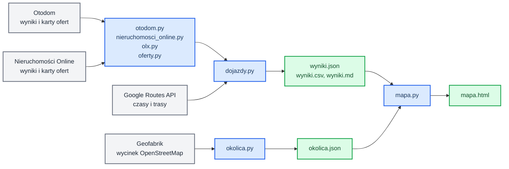
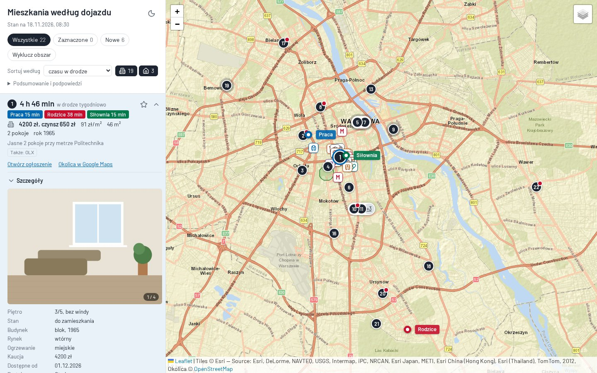
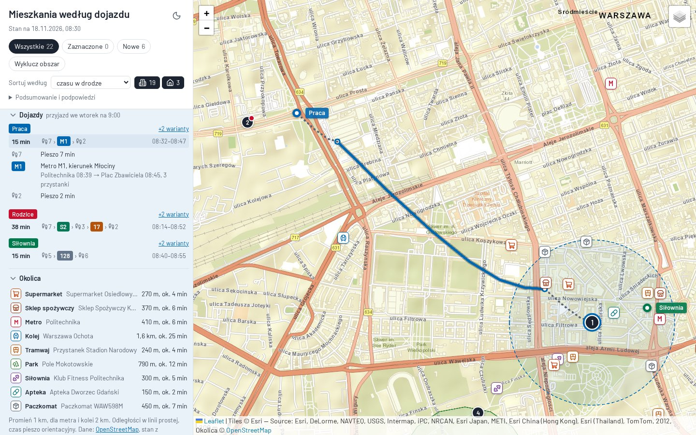
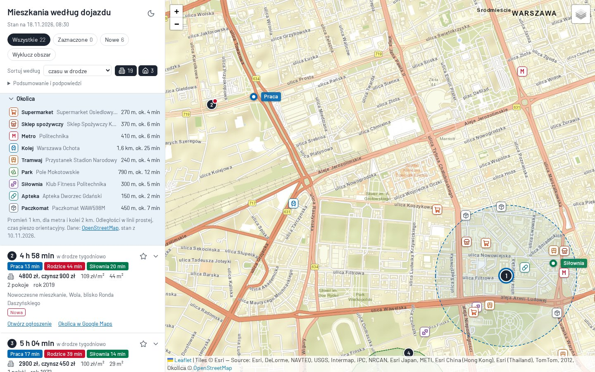
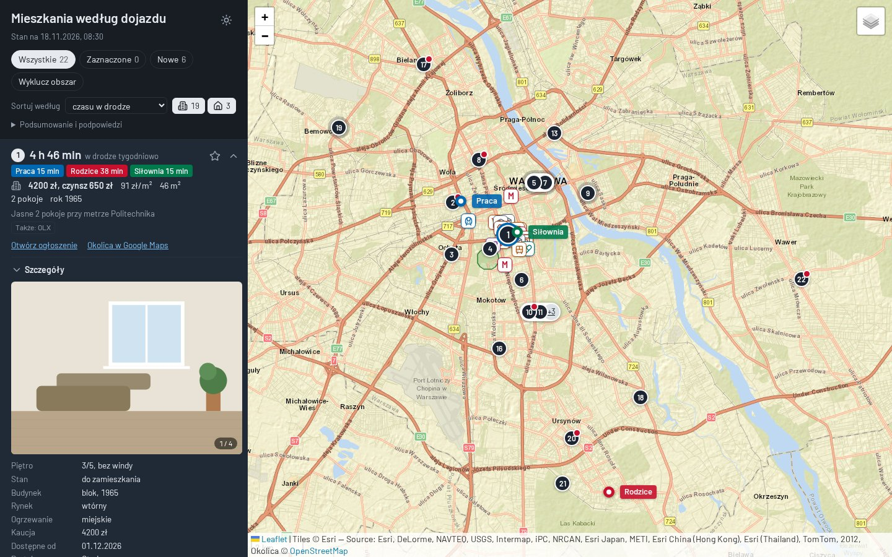
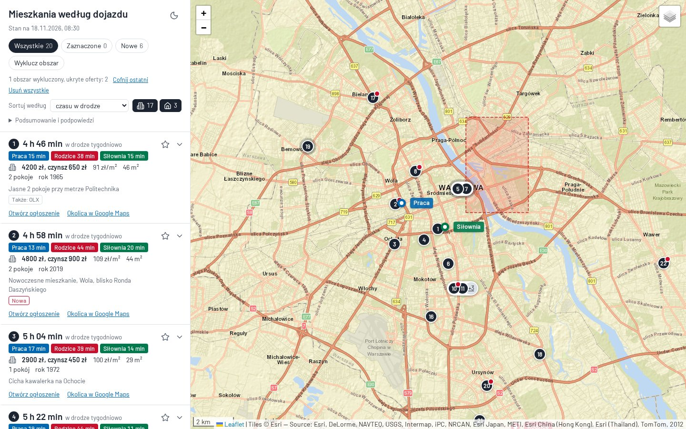
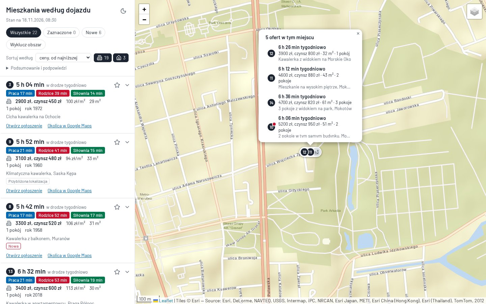

# otodom-commute-ranker

Ranking ofert mieszkań i domów z Otodom, Nieruchomości Online i OLX według łącznego czasu, który co tydzień spędzisz w komunikacji miejskiej, jeżdżąc do swoich miejsc: pracy, uczelni, rodziców, na siłownię. Cena i metraż mówią, ile płacisz za mieszkanie. Ten ranking pokazuje, ile czasu będzie Cię kosztowało mieszkanie w tym miejscu.

Wynik to tabela (Markdown i CSV) oraz strona `mapa.html` z listą ofert obok mapy. Przy każdej ofercie są zdjęcia, warianty przejazdu z przesiadkami i najbliższe sklepy, przystanki i parki.


<sub>Wszystkie zrzuty pokazują fikcyjne dane wygenerowane przez <code>docs/mock/generuj_mock.py</code>: oferty, zdjęcia i trasy są wymyślone.</sub>

Projekt jest ustawiony pod Warszawę. W innym mieście wystarczy zmienić adres wyszukiwania i wycinek danych OpenStreetMap (zobacz [Inny region](#inny-region)).

## Spis treści

- [Szybki start](#szybki-start)
- [Jak to działa](#jak-to-działa)
- [Strona z mapą](#strona-z-mapą)
- [Konfiguracja](#konfiguracja)
- [Codzienne użycie](#codzienne-użycie)
- [Pliki tworzone przez skrypty](#pliki-tworzone-przez-skrypty)
- [Koszty i limity Google](#koszty-i-limity-google)
- [Rozwiązywanie problemów](#rozwiązywanie-problemów)
- [Zrzuty ekranu i dane przykładowe](#zrzuty-ekranu-i-dane-przykładowe)
- [Źródła danych i licencje](#źródła-danych-i-licencje)

## Szybki start

Wymagania: Python 3.11 lub nowszy, [uv](https://docs.astral.sh/uv/) (albo zwykły `venv` i `pip`) oraz klucz Google Maps Platform z włączonym Routes API ([jak go zdobyć](#klucz-google)).

```bash
git clone https://github.com/Juzekkk/otodom-commute-ranker.git
cd otodom-commute-ranker

# środowisko i biblioteki: requests, tzdata, osmium
uv venv -p 3.11
source .venv/bin/activate          # Windows: .venv\Scripts\activate
uv pip install -r requirements.txt

# ustawienia
cp config.example.toml config.toml # Windows: copy config.example.toml config.toml
# w config.toml wpisz: adresy wyszukiwań (Otodom, Nieruchomości Online, OLX), klucz Google, swoje miejsca

# uruchomienie
python dojazdy.py   # oferty, czasy dojazdu, ranking, warianty tras (python dojazdy.py olx-m: tylko jedno wyszukiwanie)
python okolica.py   # sklepy, przystanki, parki (raz w miesiącu)
python mapa.py      # składa mapa.html i otwiera stronę w przeglądarce (lokalny serwer, Ctrl+C kończy)
```

Pierwsze uruchomienie `dojazdy.py` trwa najdłużej: skrypt otwiera kartę każdej oferty z przerwą 1–2 s, więc 200 ofert to ok. 8 minut. Kolejne uruchomienia pobierają tylko nowe oferty i brakujące czasy.

## Jak to działa

Dane zbierają dwa niezależne skrypty (`dojazdy.py` z kilku portali i `okolica.py` z OpenStreetMap), a `mapa.py` składa z nich stronę. Gotowa strona pobiera z sieci tylko podkład mapy, bibliotekę Leaflet, czcionkę i zdjęcia ofert.



| Skrypt | Co robi | Kiedy uruchamiać |
| --- | --- | --- |
| `dojazdy.py` | Czasy dojazdu z Google, filtry, ranking, warianty tras, pliki wynikowe. Oferty bierze z modułów poniżej | Codziennie albo kiedy chcesz |
| `okolica.py` | Sklepy, stacje, przystanki, siłownie, apteki, paczkomaty i parki z OpenStreetMap | Raz w miesiącu |
| `mapa.py` | Strona `mapa.html` z wyników i danych okolicy, bez zapytań do sieci | Po każdym z powyższych |

Zbieranie ofert jest podzielone na moduły, których nie uruchamiasz osobno:

| Moduł | Co robi |
| --- | --- |
| `oferty.py` | Łączy oferty z wielu portali w jedną listę, pobiera karty ofert, pilnuje obszarów wykluczonych (`wykluczenia.json`) i pamięci kart (`stan.json`). Nie zna szczegółów żadnego portalu |
| `otodom.py` | Wszystko o Otodom: adresy stron wyników, czytanie danych strony, karta oferty |
| `nieruchomosci_online.py` | Wszystko o Nieruchomościach Online: strona wyników, karta oferty |
| `olx.py` | Wszystko o OLX: strona wyników z gotowymi danymi ofert (bez kart) |
| `siec.py` | Wspólne pobieranie stron: ponowienia, obsługa 429, rezygnacja z portalu, który nie odpowiada ([niżej](#błędy-portali-429-i-limit-czasu)) |

Każdy portal ma ten sam zestaw funkcji (`matches`, `search`, `card`), więc dodanie kolejnego portalu to jeden nowy plik i wpis w liście `SOURCES` w `oferty.py`. Wspólny format oferty opisuje nagłówek `oferty.py`.

### dojazdy.py krok po kroku

1. **Wyszukiwanie.** Skrypt otwiera adresy z sekcji `[wyszukiwania]` w `config.toml` (po kolei, każdy może być osobnym wyszukiwaniem, np. mieszkań i domów) i przechodzi wszystkie strony wyników (Otodom: po 72 oferty, pozostałe portale po ok. 40). Portal skrypt rozpoznaje po nazwie domeny w adresie i czyta go własnym modułem (`otodom.py`, `nieruchomosci_online.py`, `olx.py`), więc portale można mieszać na jednej liście. Otodom osadza dane w każdej stronie jako JSON (`__NEXT_DATA__`) i skrypt czyta właśnie je, a nie HTML. Inwestycja deweloperska rozwija się w swoje lokale, a duplikaty odpadają.
2. **Pierwszy odsiew, bez dodatkowych zapytań.** Odpadają oferty bez ceny i inwestycje z terminem oddania po `max_rok_budowy`.
3. **Karty ofert.** Dla ofert, których skrypt jeszcze nie zna, otwiera ich karty i zapisuje w `stan.json`: współrzędne, rok budowy, parametry (piętro, winda, ogrzewanie, kaucja, wyposażenie), wszystkie zdjęcia (rzuty też, bo Otodom trzyma je razem ze zdjęciami). Oferty z obszarów wykluczonych na mapie ([zobacz niżej](#wykluczanie-obszarów)) zapisuje tylko z lokalizacją, a dalej pomija: bez czasów, tras i zdjęć. Jeśli ogłoszeniodawca ukrył dokładny adres, punkt jest środkiem okręgu, a oferta dostaje oznaczenie „przybliżona”. Po 10 pustych kartach z rzędu skrypt uznaje, że Otodom blokuje zapytania, i przerywa, zapisując postęp.
4. **Drugi odsiew.** Oferty z rokiem budowy po `max_rok_budowy` odpadają.
5. **Czasy dojazdu.** Dla każdej pary (punkt oferty, Twoje miejsce) skrypt pyta Google Compute Route Matrix o czas przejazdu komunikacją z przyjazdem **w najbliższy wtorek o 9:00** według rzeczywistych rozkładów. Pyta po 100 punktów naraz i zapisuje wynik w `czasy.json` na 30 dni. Kluczem są współrzędne, nie numer oferty, więc kilka ofert w jednym budynku kosztuje jedno zapytanie, a oferta wystawiona ponownie nie kosztuje nic. Miejsca z `max_minut` idą pierwsze: punkt, który przekracza limit, nie zużywa zapytań na pozostałe miejsca.
6. **Ranking.** Odpadają oferty bez połączenia i przekraczające `max_minut`. Pozostałe są sortowane rosnąco po tygodniowym czasie w drodze (wzór niżej).
7. **Warianty tras.** Dla ofert z rankingu skrypt pyta Google Compute Routes o maksymalnie 3 warianty przejazdu do każdego miejsca: linie, przesiadki, godziny, liczbę przystanków i kształt trasy na mapę. Zapisuje je w `trasy.json` na 30 dni.
8. **Zapis.** Powstają `wyniki.md`, `wyniki.csv` i `wyniki.json`, a w konsoli pojawia się podsumowanie i pierwsza dziesiątka.

### Wzór rankingu

Dla każdego miejsca: czas w jedną stronę × 2 (tam i z powrotem) × `razy_w_tygodniu`. Wynik to suma po wszystkich miejscach.

Przykład dla miejsc z `config.example.toml` i oferty, z której jedzie się 15 min do pracy, 38 min do rodziców i 15 min na siłownię:

| Miejsce | Czas w jedną stronę | Razy w tygodniu | Minut tygodniowo |
| --- | --: | --: | --: |
| Praca | 15 min | 5 | 15 × 2 × 5 = 150 |
| Rodzice | 38 min | 1 | 38 × 2 × 1 = 76 |
| Siłownia | 15 min | 2 | 15 × 2 × 2 = 60 |
| **Razem** | | | **286 min = 4 h 46 min** |

Oferta tańsza o 300 zł, ale z dojazdem do pracy dłuższym o 15 minut, kosztuje 2,5 godziny tygodniowo więcej, czyli ok. 10 godzin miesięcznie. Ranking pozwala zobaczyć takie różnice od razu.

Czasy dotyczą porannego szczytu we wtorek. Dla wizyt wieczornych i weekendowych to przybliżenie, bo rozkłady są wtedy rzadsze.

### Nieruchomości Online

Adresy z `nieruchomosci-online.pl` działają tak samo jak z Otodom: filtry ustawiasz na stronie portalu i kopiujesz adres wyników (np. `https://warszawa.nieruchomosci-online.pl/mieszkania,wynajem/` albo adres z `szukaj.html?...`). Różnice:

- ze strony wyników skrypt bierze tytuł, cenę, metraż, pokoje i piętro, a z karty oferty współrzędne (razem z informacją, czy lokalizacja jest przybliżona), rok budowy, piętro budynku, windę i dodatki;
- zdjęcia: wszystkie, z danych osadzonych w stronie oferty (duży rozmiar);
- brakuje ogrzewania, kaucji w części ofert, ogłoszeniodawcy i daty dodania, więc te pola są puste;
- inwestycje deweloperskie bez współrzędnych na karcie są pomijane („nie udało się pobrać karty”).

To samo mieszkanie bywa na obu portalach. Jeśli oferty z różnych portali mają tę samą cenę, metraż różniący się najwyżej o 1 m² i leżą nie dalej niż 60 m od siebie, skrypt zostawia tę z Otodom, a przy niej w sekcji Szczegóły pojawia się „Także na” z odnośnikiem do drugiego portalu. W podsumowaniu jest liczba scalonych ofert.

### OLX

Adres z działu Nieruchomości na `olx.pl` wklejasz jak każdy inny, np.:

```toml
"https://www.olx.pl/nieruchomosci/mieszkania/sprzedaz/warszawa/?search%5Bdist%5D=5&search%5Bfilter_float_price:to%5D=1200000&search%5Bfilter_float_m:from%5D=70&search%5Bfilter_enum_rooms%5D%5B0%5D=four"
```

Wszystkie filtry (cena, metraż, pokoje, odległość od miasta) ustawiasz na OLX i kopiujesz adres. Odmienności:

- strona wyników OLX zawiera komplet danych (cena, metraż, pokoje, piętro, rynek, wszystkie zdjęcia, współrzędne), więc skrypt **nie otwiera kart ofert** i pobieranie jest szybkie: ok. 40 ofert na zapytanie, bez przerw między ofertami;
- korzystamy tylko ze stron wyników, nie z API OLX;
- OLX często ukrywa dokładny adres: takie oferty mają oznaczenie „przybliżona” (punkt jest wtedy orientacyjny, a ranking z niego liczy czas dojazdu);
- rok budowy, ogrzewania, winda, kaucja i piętro budynku nie są podawane, więc filtr `max_rok_budowy` ich nie dotyczy, a te pola są puste;
- rodzaj (mieszkanie albo dom) skrypt rozpoznaje po adresie: `/domy/` w ścieżce to domy;
- na OLX „4 i więcej pokoi” jest jedną opcją, więc oferty pokazują `4+`; nazw sprzedających nie zapisujemy, tylko czy to osoba prywatna, czy firma.

Wyszukiwania bez ostrych filtrów dają tysiące ofert, a każda unikalna lokalizacja zużywa parę z darmowego limitu Google ([zobacz niżej](#koszty-i-limity-google)), więc filtry na OLX warto ustawić ciasno.

### okolica.py

Skrypt pobiera z Geofabrik wycinek OpenStreetMap dla województwa mazowieckiego (kilkaset MB, ponownie dopiero po 30 dniach) i wyciąga z niego biblioteką `osmium`:

| Rodzaj | Tagi OpenStreetMap |
| --- | --- |
| Supermarket | `shop=supermarket` |
| Sklep spożywczy | `shop=convenience` |
| Metro | `railway=station` ze `station=subway` |
| Kolej | `railway=station`, `railway=halt` |
| Tramwaj | `railway=tram_stop` |
| Siłownia | `leisure=fitness_centre` |
| Apteka | `amenity=pharmacy` |
| Paczkomat | `amenity=parcel_locker` |
| Park | `leisure=park`, jako obrys |

Obiekty zapisane w OSM jako budynki dostają punkt w środku obrysu. Obrysy parków są upraszczane, żeby plik był mniejszy. Wynik trafia do `okolica.json`, a `mapa.py` wkleja do strony tylko fragment wokół ofert z zapasem ok. 2,5 km.

### mapa.py

Skrypt niczego nie pobiera z sieci. Wkleja `wyniki.json` i przycięte `okolica.json` do strony, a najbliższe miejsca każdej oferty strona liczy sama w przeglądarce.

Domyślnie `python mapa.py` uruchamia lokalny serwer pod adresem `http://127.0.0.1:8765` (dostępny tylko z tego komputera, Ctrl+C kończy). Serwer jest potrzebny do jednej rzeczy: zapisywania obszarów wykluczonych w pliku. Port jest stały, bo przeglądarka pamięta zaznaczone oferty i ustawienia osobno dla każdego adresu. `python mapa.py --plik` tylko zapisuje `mapa.html` i otwiera go z dysku: wszystko działa, ale obszarów nie da się wtedy rysować. Bez `wyniki.json` strona pokazuje same miejsca z `config.toml`, więc obszary można zaznaczyć przed pierwszym uruchomieniem `dojazdy.py`.

## Strona z mapą

Lista ofert stoi obok mapy, a numery ofert są wspólne dla listy i mapy. Na karcie oferty są: tygodniowy czas w drodze, czasy do każdego miejsca w kolorze tego miejsca, cena z czynszem, cena za m², metraż, liczba pokoi, rok budowy i tytuł. Czerwona kropka przy numerze oznacza ofertę nową od poprzedniego uruchomienia, a szeroka, półprzezroczysta obwódka wokół znacznika oznacza przybliżoną lokalizację.

Cały nagłówek karty oferty rozwija ją i zwija: klikasz gdziekolwiek poza linkami i gwiazdką. Gwiazdka po prawej zaznacza ofertę, a numer w nagłówku karty jest tym samym, który widać na mapie. Po rozwinięciu z listy mapa nie zmienia powiększenia, a jeśli oferta leży poza środkową trzecią częścią mapy, przesuwa się tak, żeby w niej była. Rysuje okrąg o promieniu 500 m (ok. 6 minut pieszo), a lista pokazuje trzy sekcje. Każdą z nich zwija się osobno, kliknięciem w jej tytuł. Domyślnie Szczegóły są rozwinięte, a Dojazdy i Okolica zwinięte. Zmiana ustawienia jest pamiętana i obowiązuje kolejne oferty.

**Szczegóły.** Galeria wszystkich zdjęć z ogłoszenia, także rzutu (kliknięcie lewej lub prawej połowy przewija), a pod nią piętro z windą, stan, budynek, rynek, ogrzewanie, kaucja, termin dostępności, wyposażenie i dodatki.



**Dojazdy.** Najszybszy wariant do każdego miejsca: czas, odcinki pieszo i kolejne linie, godziny odjazdu i przyjazdu. Link „+2 warianty” pokazuje pozostałe. Najechanie kursorem rysuje trasę na mapie, a kliknięcie przypina ją i rozpisuje przesiadki z przystankami, kierunkiem i liczbą przystanków.



**Okolica.** Najbliższe miejsce każdego rodzaju w promieniu 1 km (dla metra i kolei 2 km) z odległością w linii prostej i orientacyjnym czasem pieszo. Kliknięcie pozycji pokazuje to miejsce na mapie.



### Mieszkania i domy

Gdy w `[wyszukiwania]` są adresy mieszkań i domów, nad listą (obok wyboru sortowania) pojawiają się dwa przyciski z ikonami budynku i domu oraz liczbą ofert. Każdy włącza lub wyłącza swój rodzaj, więc można oglądać tylko domy albo tylko mieszkania, a wybór jest zapamiętany. Zawsze zostaje włączony przynajmniej jeden. Przy ofercie widać małą ikonę jej rodzaju, a filtry „Wszystkie”, „Zaznaczone”, „Nowe” i znaczniki na mapie uwzględniają ten wybór.

Podpowiedzi o obsłudze są pod „Podsumowanie i podpowiedzi” w nagłówku listy.

### Motyw dzienny i nocny

Przycisk ze słońcem lub księżycem obok tytułu przełącza motyw. Domyślnie strona podąża za ustawieniem systemu, a Twój wybór jest zapamiętany. W motywie nocnym ciemne są panel boczny i dymki na mapie. Sama mapa, znaczki i przyciski mapy zostają takie jak w dziennym, żeby nie tracić nazw ulic i szczegółów.



### Wykluczanie obszarów

Przycisk „Wyklucz obszar” w rzędzie filtrów (obok „Wszystkie”, „Zaznaczone” i „Nowe”) włączasz lasso: przytrzymaj przycisk myszy, zakreśl na mapie obszar, który Cię nie interesuje (np. okolice lotniska), i puść. Obszar zaznacza się lekką czerwienią, a oferty z jego wnętrza znikają z listy i mapy. Kliknięcie obszaru pozwala go usunąć, „Cofnij ostatni” i „Usuń wszystkie” też działają. Esc kończy rysowanie.

Obszary zapisują się od razu w `wykluczenia.json`. `dojazdy.py` czyta ten plik, więc przy kolejnym uruchomieniu nie liczy dla takich ofert czasów ani tras i nie zapisuje ich zdjęć ani parametrów. Otodom nie podaje współrzędnych w wynikach wyszukiwania, więc karta nowej oferty jest otwierana jeszcze raz, żeby sprawdzić, czy leży w obszarze: to jedyny koszt, a Google nie jest pytany wcale. Obszary można rysować przed pierwszym uruchomieniem `dojazdy.py`.



### Sortowanie i kilka ofert w jednym miejscu

**Sortowanie.** Lista „Sortuj według” nad ofertami układa je według czasu w drodze (domyślnie), ceny, ceny za m² albo daty dodania, od najnowszych. Numery ofert zostają z rankingu dojazdów, więc przy każdym sortowaniu znaczą to samo na liście i na mapie. Oferty bez danego parametru trafiają na koniec, a przy równych wartościach wyżej jest oferta z krótszym dojazdem. Cenę i inne kryteria wyszukiwania zawężasz w `wyszukiwania`, a strona tylko zmienia kolejność.

**Wspólny znacznik.** Oferty oddalone od siebie o najwyżej 25 m, np. kilka lokali w jednym budynku albo w jednej inwestycji, dzielą na mapie jeden znacznik. Numery są na nim ułożone jak talia kart: do trzech numerów, a przy większej liczbie dwa pierwsze i „+N”. Kolejność numerów na znaczniku jest taka sama jak na liście, a rozwinięta oferta jest na nim zawsze widoczna. Kliknięcie znacznika otwiera listę ofert z tego miejsca z czasem w drodze, ceną, metrażem i liczbą pokoi, a wybór pozycji rozwija ofertę na liście, nie zamykając listy. Lista zostaje na tym samym przewinięciu i zamyka ją krzyżyk albo wybór oferty spoza tego miejsca. Karta oferty ma oznaczenie „W tym samym miejscu” z numerami pozostałych.



### Pozostałe funkcje

- Kliknięcie gwiazdki przy ofercie ją zaznacza. Filtry u góry pokazują wszystkie oferty, zaznaczone albo nowe.
- Szerokość listy zmienisz, przeciągając jej krawędź (albo strzałkami na klawiaturze). Podwójne kliknięcie przywraca domyślną.
- Zaznaczenia, sortowanie i szerokość listy zapamiętuje przeglądarka (`localStorage`), więc zostają po ponownym wygenerowaniu strony.
- Przełącznik warstw w prawym górnym rogu mapy zmienia podkład na zdjęcia satelitarne.
- Strona ma tryb ciemny zgodny z ustawieniem systemu, a na wąskim ekranie mapa przechodzi nad listę.

## Konfiguracja

Ustawienia są w `config.toml`, który tworzysz z szablonu `config.example.toml`. Szablon ma przykładowe wartości i komentarze. Plik jest w `.gitignore`, bo zawiera klucz Google.

```toml
[wyszukiwania]
otodom-m = "https://www.otodom.pl/pl/wyniki/wynajem/mieszkanie/mazowieckie/warszawa/warszawa/warszawa?priceMax=5000&roomsNumber=%5BTWO%2CTHREE%5D"
otodom-d = "https://www.otodom.pl/pl/wyniki/wynajem/dom/mazowieckie/warszawa/warszawa/warszawa?priceMax=7000"
nieruchomosci-m = "https://warszawa.nieruchomosci-online.pl/mieszkania,wynajem/"

[pobieranie]
limit_minut_na_portal = 20

[filtry]
max_rok_budowy = 2027

[google]
api_key = "..."

[[miejsca]]
nazwa = "Praca"
wspolrzedne = "52.2302, 20.9836"
razy_w_tygodniu = 5
max_minut = 40

[[miejsca]]
nazwa = "Rodzice"
wspolrzedne = "52.1311, 21.0657"
razy_w_tygodniu = 1
```

| Klucz | Znaczenie |
| --- | --- |
| `[wyszukiwania]` | Pary `nazwa = "adres"`: adresy stron z wynikami wyszukiwania na otodom.pl, nieruchomosci-online.pl i olx.pl (można mieszać). Nazwa jest dowolna (np. `otodom-m`) i służy do pobrania tylko tego wyszukiwania ([zobacz niżej](#pojedyncze-wyszukiwania)). Portale wyszukują naraz tylko mieszkania albo tylko domy, więc podajesz osobny adres dla każdego rodzaju; oferty ze wszystkich adresów trafiają do jednego rankingu. Filtry (wynajem lub sprzedaż, cena, metraż, pokoje, dzielnice, rynek) ustawiasz w przeglądarce i kopiujesz adres. Im węższe wyszukiwania, tym szybsze pierwsze uruchomienie. Starsze zapisy (lista adresów `wyszukiwania = [...]`, `otodom_urls`, `otodom_url`) nadal działają, a nazwami są wtedy numery 1, 2, ... |
| `[pobieranie] limit_minut_na_portal` | Najdłuższy czas na jeden portal w jednym uruchomieniu (domyślnie 20 min). Po jego przekroczeniu skrypt przestaje pytać ten portal i idzie dalej ([zobacz niżej](#błędy-portali-429-i-limit-czasu)) |
| `[filtry] max_rok_budowy` | Pomija oferty z późniejszym rokiem budowy i inwestycje z późniejszym terminem oddania. Usuń linię, jeśli nie chcesz tego filtra. Oferty bez ceny są pomijane zawsze |
| `[google] api_key` | Klucz Google Maps Platform z włączonym Routes API |
| `[[miejsca]] nazwa` | Nazwa miejsca na liście i mapie |
| `[[miejsca]] wspolrzedne` | Np. `"52.2297, 21.0122"`. W Google Maps kliknij miejsce prawym przyciskiem i kliknij liczby na górze menu, a skopiują się w tym formacie |
| `[[miejsca]] razy_w_tygodniu` | Waga miejsca: ile razy w tygodniu tam jeździsz. Domyślnie 1 |
| `[[miejsca]] max_minut` | Opcjonalny limit: oferty z dłuższym dojazdem w jedną stronę odpadają |

Miejsc może być dowolnie wiele. Na mapie dostają kolejne kolory: niebieski, czerwony, zielony, fioletowy, pomarańczowy i morski.

### Klucz Google

1. W [Google Cloud Console](https://console.cloud.google.com/) utwórz projekt.
2. Podepnij konto rozliczeniowe. Google wymaga karty nawet przy korzystaniu wyłącznie z darmowego limitu.
3. Włącz **Routes API**. Obejmuje ono zarówno macierz czasów, jak i trasy.
4. W „Dane logowania” utwórz klucz API i ogranicz go do Routes API.
5. Wpisz klucz do `config.toml`.

Warto ustawić w konsoli alert budżetowy, np. na 1 zł. Nie blokuje on zapytań, ale wyśle maila, gdy cokolwiek zacznie kosztować.

### Inny region

Oferty bierzesz z dowolnych wyszukiwań na obsługiwanych portalach, więc dla innego miasta wystarczą inne `wyszukiwania` i inne `[[miejsca]]`. Dane okolicy `okolica.py` pobiera z wycinka dla województwa mazowieckiego. Dla innego regionu zmień stałą `EXTRACT_URL` w `okolica.py` na odpowiedni plik z [download.geofabrik.de](https://download.geofabrik.de/) i usuń stary plik `.osm.pbf`.

## Codzienne użycie

```bash
python dojazdy.py && python mapa.py
```

Przy kolejnych uruchomieniach skrypt:

- otwiera karty tylko nowych ofert, a ich współrzędne bierze z `stan.json`,
- pyta Google tylko o punkty, których jeszcze nie zna, albo o czasy starsze niż 30 dni,
- oznacza nowe oferty w `wyniki.md` (osobna sekcja „Nowe od ostatniego uruchomienia”), w CSV (kolumna `nowa`) i na mapie (czerwona kropka, filtr „Nowe”).

Przykładowe podsumowanie w konsoli:

```text
Wyniki: strona 3/3, ofert: 212
Pobieram karty 18 ofert (ok. 1 min)...
Ofert w wyszukiwaniu: 212. Pominięte przed liczeniem dojazdów: bez ceny: 6, rok budowy po 2027: 11.
W limitach dojazdu: 143 z 195 (nowych: 9).
Google w tym miesiącu (licznik skryptu): 1 240 z 9 000 par (darmowo do 10 000).
Google, trasy w tym miesiącu: 186 z 9 000 zapytań (osobna pula, darmowo do 10 000).
Ranking: wyniki.md (do czytania), wyniki.csv (do Excela), mapa: python mapa.py. Najlepsze 10:
  286 min/tydz. | Praca 15, Rodzice 38, Siłownia 15 | 4200 zł | 46 m2 | https://www.otodom.pl/pl/oferta/...
```

### Formaty wyników

`wyniki.md` to tabela do czytania w edytorze albo na GitHubie:

| # | Tydzień | Dojazdy [min] | Mieszkanie | Oferta |
| --: | --: | --- | --- | --- |
| **1** | 4 h 46 min | Praca 15 · Rodzice 38 · Siłownia 15 | 4 200 zł (czynsz 650 zł) · 46 m² · 2 pok. · rok 1965 | Jasne 2 pokoje przy metrze… |
| **2** | 4 h 48 min | ≈ Praca 12 · Rodzice 40 · Siłownia 17 | 2 900 zł (czynsz 450 zł) · 29 m² · 1 pok. · rok 1972 | nowa · Cicha kawalerka na Ochocie |

Znak ≈ oznacza przybliżoną lokalizację oferty.

`wyniki.csv` ma średnik jako separator i BOM, więc polski Excel od razu rozdziela kolumny i pokazuje polskie znaki. Kolumny: tygodniowy czas, czas do każdego miejsca, cena, czynsz, zł/m², m², pokoje, rok budowy, nowa, lokalizacja, tytuł, link.

### Zmiana miejsc

Czasy są zapamiętywane dla pary (punkt oferty, współrzędne miejsca). Zmiana `nazwa`, `razy_w_tygodniu` albo `max_minut` nie kosztuje żadnych zapytań, bo ranking przelicza się z zapamiętanych czasów. Nowe miejsce albo zmienione współrzędne oznaczają nowe zapytania dla wszystkich ofert.

### Pojedyncze wyszukiwania

Każde wyszukiwanie w `[wyszukiwania]` ma nazwę. Bez argumentów `python dojazdy.py` pobiera wszystkie. Z nazwami pobiera tylko wskazane:

```bash
python dojazdy.py olx-m               # tylko OLX, mieszkania
python dojazdy.py otodom-m otodom-d   # kilka naraz
```

Pozostałe wyszukiwania nie są pytane o nic: ranking, mapa i `wyniki.*` zawierają je dalej, z ofertami zapisanymi przy ich ostatnim pobraniu (`ogloszenia.json`). Cała reszta potoku działa jak zwykle (zapamiętane karty, czasy i trasy). W podsumowaniu jest wtedy informacja, z kiedy pochodzą oferty z nieodświeżanych wyszukiwań. Dzięki temu można np. odświeżać OLX codziennie, a Otodom raz w tygodniu.

- **Pierwsze uruchomienie musi być pełne**, bez argumentów: dopiero ono zapisuje oferty wszystkich wyszukiwań. Częściowe uruchomienie wyszukiwania, którego jeszcze nie pobrano, pomija je w rankingu i mówi o tym w podsumowaniu.
- Zmiana adresu przy nazwie unieważnia zapisane oferty tego wyszukiwania. Błędna nazwa kończy się listą nazw z `config.toml`.
- Gdy pobieranie wyszukiwania się nie powiedzie (np. błąd 429), poprzednio zapisane oferty tego wyszukiwania zostają, a nowe je uzupełniają.

## Pliki tworzone przez skrypty

Wszystkie są w `.gitignore`, bo zawierają dane pobrane z sieci albo Twoje wyniki.

| Plik | Zawartość | Tworzy |
| --- | --- | --- |
| `stan.json` | Współrzędne, rok budowy, parametry i zdjęcia ofert, żeby nie otwierać ich kart ponownie | `dojazdy.py` (przez `oferty.py`) |
| `ogloszenia.json` | Oferty z ostatniego pobrania każdego wyszukiwania, żeby dało się odświeżyć tylko wybrane | `dojazdy.py` (przez `oferty.py`) |
| `czasy.json` | Czasy dojazdu (ważne 30 dni) i licznik zapytań o czasy | `dojazdy.py` |
| `trasy.json` | Warianty tras (ważne 30 dni) i licznik zapytań o trasy | `dojazdy.py` |
| `wyniki.md`, `wyniki.csv`, `wyniki.json` | Ranking: do czytania, do Excela, dla strony | `dojazdy.py` |
| `mazowieckie-latest.osm.pbf` | Wycinek OpenStreetMap, kilkaset MB, odświeżany co 30 dni | `okolica.py` |
| `okolica.json` | Sklepy, przystanki, stacje i parki z regionu | `okolica.py` |
| `wykluczenia.json` | Obszary wykluczone na mapie (wieloboki ze współrzędnych) | `mapa.py` |
| `mapa.html` | Strona z listą i mapą | `mapa.py` |

Nie usuwaj `czasy.json` ani `trasy.json`. Oprócz zapamiętanych wyników trzymają liczniki zapytań, dzięki którym skrypt nie przekracza darmowego limitu Google. Usunięcie `stan.json` jest bezpieczne, ale skrypt otworzy wtedy od nowa karty wszystkich ofert.

Postęp jest zapisywany także po przerwaniu klawiszami Ctrl+C, więc przerwane pierwsze uruchomienie można po prostu wznowić.

## Koszty i limity Google

Google ma dla obu usług osobne darmowe pule, a skrypt pilnuje ich własnymi licznikami z zapasem.

| Usługa Google | Rozliczanie | Darmowo w miesiącu | Limit w skrypcie |
| --- | --- | --- | --- |
| Compute Route Matrix: czasy dojazdu | Za każdą parę oferta × miejsce[^2] | 10 000[^1] | 9 000 par |
| Compute Routes: warianty tras | Za zapytanie, do 3 wariantów w jednym[^2] | 10 000[^1] | 9 000 zapytań |

Przykład: wyszukiwanie z 200 ofertami i 3 miejscami to przy pierwszym uruchomieniu najwyżej 600 par na czasy, a zwykle mniej, bo oferty spoza `max_minut` odpadają po pierwszym miejscu. Do tego 3 zapytania o trasy na każdą ofertę z rankingu. Kolejne uruchomienia w ciągu 30 dni pytają tylko o nowe punkty.

- **Miesiąc liczony jak u Google.** Darmowy limit odnawia się o północy czasu pacyficznego[^3], czyli w Polsce ok. 9:00 pierwszego dnia miesiąca. Liczniki skryptu liczą miesiąc tak samo.
- **Po wyczerpaniu limitu** skrypt nie pyta dalej. Oferty bez policzonego czasu pomija i policzy je w kolejnym miesiącu.
- **Limit jest wspólny dla konta.** Licznik skryptu nie widzi innego użycia tego samego konta rozliczeniowego, a Google sumuje darmową pulę dla wszystkich projektów na koncie[^3].
- **Portale nie mają publicznego API.** Skrypt czyta strony tak jak przeglądarka, z przerwami 1–2 s między zapytaniami. Regulamin portalu nie przewiduje automatycznego pobierania ofert, więc to narzędzie wyłącznie do prywatnego użytku.
- **Okolica nie wysyła zapytań.** Dane pochodzą z wycinka pobieranego raz w miesiącu, a strona liczy odległości lokalnie.

## Rozwiązywanie problemów

| Komunikat | Przyczyna | Co zrobić |
| --- | --- | --- |
| `Brak config.toml` | Nie ma pliku ustawień | Skopiuj `config.example.toml` do `config.toml` i uzupełnij |
| `Uzupełnij api_key` | Pusty klucz w `config.toml` | Wpisz klucz Google |
| `Miejsce "…": wpisz współrzędne` | Zły format `wspolrzedne` | Wpisz `"szerokość, długość"`, np. `"52.2297, 21.0122"` |
| `Uwaga, wyniki mogą być niepełne: …` w podsumowaniu | Portal zwracał błędy (429, 403, 5xx) albo minął limit czasu | Nic nie psuje się: ranking powstał z tego, co udało się pobrać. Uruchom ponownie później, brakujące karty zostaną dociągnięte |
| `Nie pobrano żadnych ofert` | Żaden portal nie odpowiedział albo adresy są błędne | Sprawdź adresy w przeglądarce, odczekaj kilka godzin |
| `Nieznany portal w adresie wyszukiwania` | Adres spoza obsługiwanych portali | Użyj adresu z otodom.pl, nieruchomosci-online.pl albo olx.pl |
| `Brak ofert do policzenia` | Wszystkie oferty odpadły w filtrach | Poluzuj filtry na Otodom albo `max_rok_budowy` |
| `Błąd Google Routes API (HTTP 403)` | Routes API nie jest włączone albo brak konta rozliczeniowego | Sprawdź projekt w Google Cloud Console |
| `Wykorzystano limit …` | Skrypt doszedł do swojego miesięcznego limitu | Brakujące czasy i trasy policzy w kolejnym miesiącu |
| `Google odrzuca zapytania (HTTP 429)` | Limit na minutę albo limit ustawiony w konsoli | Brakujące dane pobierze przy kolejnym uruchomieniu |
| `Nie udało się uruchomić serwera na porcie 8765` | Port zajęty (np. drugi `mapa.py`) | Zamknij drugi program; do tego czasu strona otwiera się z dysku, bez rysowania obszarów |
| `Nie umiem odczytać wykluczenia.json` | Uszkodzony plik z obszarami | Usuń plik i narysuj obszary od nowa |
| `Brak okolica.json` | Nie uruchomiono `okolica.py` | Uruchom `python okolica.py`, potem `python mapa.py` |
| Na stronie: „Tras jeszcze nie pobrano” | Trasy nie zmieściły się w limicie albo był błąd | Uruchom ponownie `python dojazdy.py` |

### Błędy portali (429 i limit czasu)

Portal, który uzna, że pytamy za często, odpowiada „too many requests” (HTTP 429) albo błędem serwera. Skrypt nie czeka wtedy w nieskończoność na komplet ofert (`siec.py`):

1. **Ponowienia.** Zapytanie jest ponawiane do 4 razy z rosnącą przerwą (5, 10 i 20 s). Jeśli portal poda w nagłówku `Retry-After`, skrypt czeka tyle, ile on prosi, ale nie dłużej niż minutę. Po błędzie 429 skrypt zwalnia też tempo kolejnych zapytań.
2. **Rezygnacja z portalu.** Po 3 nieudanych zapytaniach z rzędu (każde po wszystkich ponowieniach) albo po przekroczeniu limitu czasu portal jest uznany za zablokowany do końca uruchomienia. Kolejne zapytania do niego kończą się natychmiast. Błąd 403 (portal nas odrzuca) liczy się od razu jako nieudane zapytanie, bez ponowień. Kolejne 10 kart z rzędu bez danych też blokuje portal.
3. **Dalszy ciąg.** Skrypt idzie do następnych kroków z tym, co już pobrał, a drugi portal działa normalnie. W podsumowaniu (`wyniki.md` i strona) pojawia się „Uwaga, wyniki mogą być niepełne” z opisem, co poszło nie tak. Oferty, których karty nie udało się pobrać, są pomijane tym razem, a kolejne uruchomienie dociągnie brakujące (pobrane karty są w `stan.json`).

Trzeba pamiętać, że oferty z przerwanego wyszukiwania, których nie pobrano, nie ma w rankingu z tego uruchomienia. Przy blokadzie od razu na pierwszej stronie portal nie wnosi ofert wcale.

## Zrzuty ekranu i dane przykładowe

Zrzuty w `docs/img` powstają z fikcyjnych danych, bez Otodom i bez klucza Google:

```bash
python docs/mock/generuj_mock.py   # docs/mock/wyniki.json, okolica.json i mapa.html
pip install playwright             # tylko do zrzutów; korzysta z zainstalowanego Google Chrome
python docs/mock/zrzuty.py         # docs/img/*.jpg w rozdzielczości 1440×900
```

`docs/mock/mapa.html` można też po prostu otworzyć w przeglądarce, żeby obejrzeć stronę bez konfiguracji.

## Źródła danych i licencje

- **Oferty:** [Otodom](https://www.otodom.pl/), [Nieruchomości Online](https://www.nieruchomosci-online.pl/) i [OLX](https://www.olx.pl/nieruchomosci/), wyłącznie do prywatnego użytku.
- **Czasy i trasy:** Google Maps Platform, Routes API. Wyniki są przechowywane najwyżej 30 dni.
- **Okolica:** © współtwórcy OpenStreetMap, licencja ODbL[^4], wycinki z Geofabrik[^5]. Okolica pochodzi z wycinka, a nie z zapytań na żywo, bo publiczne serwery Overpass API są stale przeciążone[^6].
- **Podkład mapy:** Esri World Street Map i World Imagery, z atrybucją na mapie. Kafelki OpenStreetMap nie są używane, bo ich serwery wymagają nagłówka Referer[^7], którego strona otwierana z dysku nie wysyła.
- **Biblioteki i zasoby strony:** [Leaflet](https://leafletjs.com/) (BSD-2-Clause), ikony [Lucide](https://lucide.dev/) (ISC), czcionka Barlow (SIL Open Font License).

[^1]: Google Maps Platform, cennik usług: <https://developers.google.com/maps/billing-and-pricing/pricing>
[^2]: Routes API, zasady rozliczania: <https://developers.google.com/maps/documentation/routes/usage-and-billing>
[^3]: Google Maps Platform, rozliczenia i darmowy limit: <https://developers.google.com/maps/billing/overview/>
[^4]: OpenStreetMap, prawa autorskie i licencja: <https://www.openstreetmap.org/copyright>
[^5]: Geofabrik, pliki do pobrania: <https://download.geofabrik.de/>
[^6]: Zgłoszenie o przeciążeniu publicznego Overpass API, listopad 2026: <https://github.com/b1tw153/Overpass-API/issues/26>
[^7]: Zasady korzystania z kafelków OpenStreetMap: <https://operations.osmfoundation.org/policies/tiles/>
