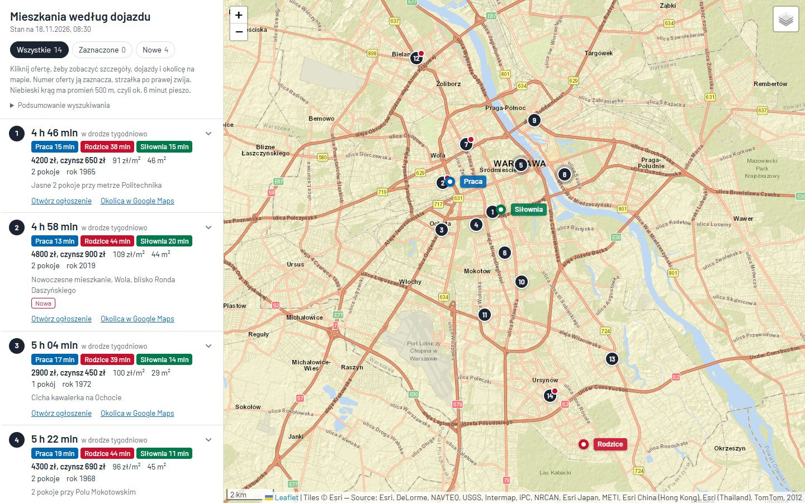
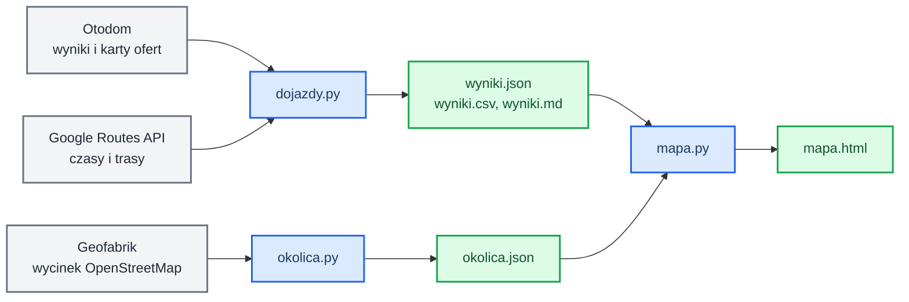

# commute-ranker

Ranking ofert mieszkań z Otodom według łącznego czasu, który co tydzień spędzisz w komunikacji miejskiej, jeżdżąc do swoich miejsc: pracy, uczelni, rodziców, na siłownię. Cena i metraż mówią, ile płacisz za mieszkanie. Ten ranking pokazuje, ile czasu będzie Cię kosztowało mieszkanie w tym miejscu.

Wynik to tabela (Markdown i CSV) oraz strona `mapa.html` z listą ofert obok mapy. Przy każdej ofercie są zdjęcia, rzut, warianty przejazdu z przesiadkami i najbliższe sklepy, przystanki i parki.



<sub>Wszystkie zrzuty pokazują fikcyjne dane wygenerowane przez <code>docs/mock/generuj_mock.py</code>: oferty, zdjęcia, rzuty i trasy są wymyślone.</sub>

Projekt jest ustawiony pod Warszawę. W innym mieście wystarczy zmienić adres wyszukiwania i wycinek danych OpenStreetMap (zobacz [Inny region](#inny-region)).

## Spis treści

- [Szybki start](#szybki-start)
- [Jak to działa](#jak-to-działa)
- [Strona z mapą](#strona-z-mapą)
- [Konfiguracja](#konfiguracja)
- [Codzienne użycie](#codzienne-użycie)
- [Pliki tworzone przez skrypty](#pliki-tworzone-przez-skrypty)
- [Koszty i limity Google](#koszty-i-limity-google)
- [Rozwiązywanie problemów](#rozwiązywanie-problemów)
- [Zrzuty ekranu i dane przykładowe](#zrzuty-ekranu-i-dane-przykładowe)
- [Źródła danych i licencje](#źródła-danych-i-licencje)

## Szybki start

Wymagania: Python 3.11 lub nowszy, [uv](https://docs.astral.sh/uv/) (albo zwykły `venv` i `pip`) oraz klucz Google Maps Platform z włączonym Routes API ([jak go zdobyć](#klucz-google)).

```bash
git clone https://github.com/Juzekkk/commute-ranker.git
cd commute-ranker

# środowisko i biblioteki: requests, tzdata, osmium
uv venv -p 3.11
source .venv/bin/activate          # Windows: .venv\Scripts\activate
uv pip install -r requirements.txt

# ustawienia
cp config.example.toml config.toml # Windows: copy config.example.toml config.toml
# w config.toml wpisz: adres wyszukiwania Otodom, klucz Google, swoje miejsca

# uruchomienie
python dojazdy.py   # oferty, czasy dojazdu, ranking, warianty tras
python okolica.py   # sklepy, przystanki, parki (raz w miesiącu)
python mapa.py      # składa mapa.html i otwiera ją w przeglądarce
```

Pierwsze uruchomienie `dojazdy.py` trwa najdłużej: skrypt otwiera kartę każdej oferty z przerwą 1–2 s, więc 200 ofert to ok. 8 minut. Kolejne uruchomienia pobierają tylko nowe oferty i brakujące czasy.

## Jak to działa

Dane zbierają dwa niezależne skrypty, a trzeci składa z nich stronę. Gotowa strona pobiera z sieci tylko podkład mapy, bibliotekę Leaflet, czcionkę i zdjęcia ofert.



| Skrypt | Co robi | Kiedy uruchamiać |
| --- | --- | --- |
| `dojazdy.py` | Oferty z Otodom, filtry, czasy dojazdu, ranking, warianty tras | Codziennie albo kiedy chcesz |
| `okolica.py` | Sklepy, stacje, przystanki, siłownie, apteki, paczkomaty i parki z OpenStreetMap | Raz w miesiącu |
| `mapa.py` | Strona `mapa.html` z wyników i danych okolicy, bez zapytań do sieci | Po każdym z powyższych |

### dojazdy.py krok po kroku

1. **Wyszukiwanie.** Skrypt otwiera adres `otodom_url` z `config.toml` i przechodzi wszystkie strony wyników po 72 oferty. Otodom osadza dane w każdej stronie jako JSON (`__NEXT_DATA__`) i skrypt czyta właśnie je, a nie HTML. Inwestycja deweloperska rozwija się w swoje lokale, a duplikaty odpadają.
2. **Pierwszy odsiew, bez dodatkowych zapytań.** Odpadają oferty bez ceny i inwestycje z terminem oddania po `max_rok_budowy`.
3. **Karty ofert.** Dla ofert, których skrypt jeszcze nie zna, otwiera ich karty i zapisuje w `stan.json`: współrzędne, rok budowy, parametry (piętro, winda, ogrzewanie, kaucja, wyposażenie), wszystkie zdjęcia i rzut. Jeśli ogłoszeniodawca ukrył dokładny adres, punkt jest środkiem okręgu, a oferta dostaje oznaczenie „przybliżona”. Po 10 pustych kartach z rzędu skrypt uznaje, że Otodom blokuje zapytania, i przerywa, zapisując postęp.
4. **Drugi odsiew.** Oferty z rokiem budowy po `max_rok_budowy` odpadają.
5. **Czasy dojazdu.** Dla każdej pary (punkt oferty, Twoje miejsce) skrypt pyta Google Compute Route Matrix o czas przejazdu komunikacją z przyjazdem **w najbliższy wtorek o 9:00** według rzeczywistych rozkładów. Pyta po 100 punktów naraz i zapisuje wynik w `czasy.json` na 30 dni. Kluczem są współrzędne, nie numer oferty, więc kilka ofert w jednym budynku kosztuje jedno zapytanie, a oferta wystawiona ponownie nie kosztuje nic. Miejsca z `max_minut` idą pierwsze: punkt, który przekracza limit, nie zużywa zapytań na pozostałe miejsca.
6. **Ranking.** Odpadają oferty bez połączenia i przekraczające `max_minut`. Pozostałe są sortowane rosnąco po tygodniowym czasie w drodze (wzór niżej).
7. **Warianty tras.** Dla ofert z rankingu skrypt pyta Google Compute Routes o maksymalnie 3 warianty przejazdu do każdego miejsca: linie, przesiadki, godziny, liczbę przystanków i kształt trasy na mapę. Zapisuje je w `trasy.json` na 30 dni.
8. **Zapis.** Powstają `wyniki.md`, `wyniki.csv` i `wyniki.json`, a w konsoli pojawia się podsumowanie i pierwsza dziesiątka.

### Wzór rankingu

Dla każdego miejsca: czas w jedną stronę × 2 (tam i z powrotem) × `razy_w_tygodniu`. Wynik to suma po wszystkich miejscach.

Przykład dla miejsc z `config.example.toml` i oferty, z której jedzie się 15 min do pracy, 38 min do rodziców i 15 min na siłownię:

| Miejsce | Czas w jedną stronę | Razy w tygodniu | Minut tygodniowo |
| --- | --: | --: | --: |
| Praca | 15 min | 5 | 15 × 2 × 5 = 150 |
| Rodzice | 38 min | 1 | 38 × 2 × 1 = 76 |
| Siłownia | 15 min | 2 | 15 × 2 × 2 = 60 |
| **Razem** | | | **286 min = 4 h 46 min** |

Oferta tańsza o 300 zł, ale z dojazdem do pracy dłuższym o 15 minut, kosztuje 2,5 godziny tygodniowo więcej, czyli ok. 10 godzin miesięcznie. Ranking pozwala zobaczyć takie różnice od razu.

Czasy dotyczą porannego szczytu we wtorek. Dla wizyt wieczornych i weekendowych to przybliżenie, bo rozkłady są wtedy rzadsze.

### okolica.py

Skrypt pobiera z Geofabrik wycinek OpenStreetMap dla województwa mazowieckiego (kilkaset MB, ponownie dopiero po 30 dniach) i wyciąga z niego biblioteką `osmium`:

| Rodzaj | Tagi OpenStreetMap |
| --- | --- |
| Supermarket | `shop=supermarket` |
| Sklep spożywczy | `shop=convenience` |
| Metro | `railway=station` ze `station=subway` |
| Kolej | `railway=station`, `railway=halt` |
| Tramwaj | `railway=tram_stop` |
| Siłownia | `leisure=fitness_centre` |
| Apteka | `amenity=pharmacy` |
| Paczkomat | `amenity=parcel_locker` |
| Park | `leisure=park`, jako obrys |

Obiekty zapisane w OSM jako budynki dostają punkt w środku obrysu. Obrysy parków są upraszczane, żeby plik był mniejszy. Wynik trafia do `okolica.json`, a `mapa.py` wkleja do strony tylko fragment wokół ofert z zapasem ok. 2,5 km.

### mapa.py

Skrypt niczego nie pobiera. Wkleja `wyniki.json` i przycięte `okolica.json` do jednego pliku HTML, który działa z dysku, bez serwera. Najbliższe miejsca każdej oferty strona liczy sama w przeglądarce.

## Strona z mapą

Lista ofert stoi obok mapy, a numery ofert są wspólne dla listy i mapy. Na karcie oferty są: tygodniowy czas w drodze, czasy do każdego miejsca w kolorze tego miejsca, cena z czynszem, cena za m², metraż, liczba pokoi, rok budowy i tytuł. Czerwona kropka przy numerze oznacza ofertę nową od poprzedniego uruchomienia, a szeroka, półprzezroczysta obwódka wokół znacznika oznacza przybliżoną lokalizację.

Po kliknięciu oferty mapa przybliża się do niej i rysuje okrąg o promieniu 500 m (ok. 6 minut pieszo), a lista rozwija trzy sekcje.

**Szczegóły.** Galeria wszystkich zdjęć (kliknięcie lewej lub prawej połowy przewija), pod nią rzut, jeśli ogłoszeniodawca go dodał, a dalej piętro z windą, stan, budynek, rynek, ogrzewanie, kaucja, termin dostępności, wyposażenie i dodatki.


**Dojazdy.** Najszybszy wariant do każdego miejsca: czas, odcinki pieszo i kolejne linie, godziny odjazdu i przyjazdu. Link „+2 warianty” pokazuje pozostałe. Najechanie kursorem rysuje trasę na mapie, a kliknięcie przypina ją i rozpisuje przesiadki z przystankami, kierunkiem i liczbą przystanków.


**Okolica.** Najbliższe miejsce każdego rodzaju w promieniu 1 km (dla metra i kolei 2 km) z odległością w linii prostej i orientacyjnym czasem pieszo. Kliknięcie pozycji pokazuje to miejsce na mapie.


Pozostałe funkcje:

- Kliknięcie numeru oferty ją zaznacza. Filtry u góry pokazują wszystkie oferty, zaznaczone albo nowe.
- Szerokość listy zmienisz, przeciągając jej krawędź (albo strzałkami na klawiaturze). Podwójne kliknięcie przywraca domyślną.
- Zaznaczenia i szerokość listy zapamiętuje przeglądarka (`localStorage`), więc zostają po ponownym wygenerowaniu strony.
- Przełącznik warstw w prawym górnym rogu mapy zmienia podkład na zdjęcia satelitarne.
- Strona ma tryb ciemny zgodny z ustawieniem systemu, a na wąskim ekranie mapa przechodzi nad listę.

## Konfiguracja

Ustawienia są w `config.toml`, który tworzysz z szablonu `config.example.toml`. Szablon ma przykładowe wartości i komentarze. Plik jest w `.gitignore`, bo zawiera klucz Google.

```toml
otodom_url = "https://www.otodom.pl/pl/wyniki/wynajem/mieszkanie/mazowieckie/warszawa/warszawa/warszawa?priceMax=5000&roomsNumber=%5BTWO%2CTHREE%5D"

[filtry]
max_rok_budowy = 2027

[google]
api_key = "..."

[[miejsca]]
nazwa = "Praca"
wspolrzedne = "52.2302, 20.9836"
razy_w_tygodniu = 5
max_minut = 40

[[miejsca]]
nazwa = "Rodzice"
wspolrzedne = "52.1311, 21.0657"
razy_w_tygodniu = 1
```

| Klucz | Znaczenie |
| --- | --- |
| `otodom_url` | Adres strony z wynikami wyszukiwania na otodom.pl. Filtry (wynajem lub sprzedaż, cena, metraż, pokoje, dzielnice, rynek) ustawiasz w przeglądarce i kopiujesz adres. Im węższe wyszukiwanie, tym szybsze pierwsze uruchomienie |
| `[filtry] max_rok_budowy` | Pomija oferty z późniejszym rokiem budowy i inwestycje z późniejszym terminem oddania. Usuń linię, jeśli nie chcesz tego filtra. Oferty bez ceny są pomijane zawsze |
| `[google] api_key` | Klucz Google Maps Platform z włączonym Routes API |
| `[[miejsca]] nazwa` | Nazwa miejsca na liście i mapie |
| `[[miejsca]] wspolrzedne` | Np. `"52.2297, 21.0122"`. W Google Maps kliknij miejsce prawym przyciskiem i kliknij liczby na górze menu, a skopiują się w tym formacie |
| `[[miejsca]] razy_w_tygodniu` | Waga miejsca: ile razy w tygodniu tam jeździsz. Domyślnie 1 |
| `[[miejsca]] max_minut` | Opcjonalny limit: oferty z dłuższym dojazdem w jedną stronę odpadają |

Miejsc może być dowolnie wiele. Na mapie dostają kolejne kolory: niebieski, czerwony, zielony, fioletowy, pomarańczowy i morski.

### Klucz Google

1. W [Google Cloud Console](https://console.cloud.google.com/) utwórz projekt.
2. Podepnij konto rozliczeniowe. Google wymaga karty nawet przy korzystaniu wyłącznie z darmowego limitu.
3. Włącz **Routes API**. Obejmuje ono zarówno macierz czasów, jak i trasy.
4. W „Dane logowania” utwórz klucz API i ogranicz go do Routes API.
5. Wpisz klucz do `config.toml`.

Warto ustawić w konsoli alert budżetowy, np. na 1 zł. Nie blokuje on zapytań, ale wyśle maila, gdy cokolwiek zacznie kosztować.

### Inny region

Oferty bierzesz z dowolnego wyszukiwania Otodom, więc dla innego miasta wystarczy inny `otodom_url` i inne `[[miejsca]]`. Dane okolicy `okolica.py` pobiera z wycinka dla województwa mazowieckiego. Dla innego regionu zmień stałą `EXTRACT_URL` w `okolica.py` na odpowiedni plik z [download.geofabrik.de](https://download.geofabrik.de/) i usuń stary plik `.osm.pbf`.

## Codzienne użycie

```bash
python dojazdy.py && python mapa.py
```

Przy kolejnych uruchomieniach skrypt:

- otwiera karty tylko nowych ofert, a ich współrzędne bierze z `stan.json`,
- pyta Google tylko o punkty, których jeszcze nie zna, albo o czasy starsze niż 30 dni,
- oznacza nowe oferty w `wyniki.md` (osobna sekcja „Nowe od ostatniego uruchomienia”), w CSV (kolumna `nowa`) i na mapie (czerwona kropka, filtr „Nowe”).

Przykładowe podsumowanie w konsoli:

```text
Wyniki: strona 3/3, ofert: 212
Pobieram karty 18 ofert (ok. 1 min)...
Ofert w wyszukiwaniu: 212. Pominięte przed liczeniem dojazdów: bez ceny: 6, rok budowy po 2027: 11.
W limitach dojazdu: 143 z 195 (nowych: 9).
Google w tym miesiącu (licznik skryptu): 1 240 z 9 000 par (darmowo do 10 000).
Google, trasy w tym miesiącu: 186 z 9 000 zapytań (osobna pula, darmowo do 10 000).
Ranking: wyniki.md (do czytania), wyniki.csv (do Excela), mapa: python mapa.py. Najlepsze 10:
  286 min/tydz. | Praca 15, Rodzice 38, Siłownia 15 | 4200 zł | 46 m2 | https://www.otodom.pl/pl/oferta/...
```

### Formaty wyników

`wyniki.md` to tabela do czytania w edytorze albo na GitHubie:

| # | Tydzień | Dojazdy [min] | Mieszkanie | Oferta |
| --: | --: | --- | --- | --- |
| **1** | 4 h 46 min | Praca 15 · Rodzice 38 · Siłownia 15 | 4 200 zł (czynsz 650 zł) · 46 m² · 2 pok. · rok 1965 | Jasne 2 pokoje przy metrze… |
| **2** | 4 h 48 min | ≈ Praca 12 · Rodzice 40 · Siłownia 17 | 2 900 zł (czynsz 450 zł) · 29 m² · 1 pok. · rok 1972 | nowa · Cicha kawalerka na Ochocie |

Znak ≈ oznacza przybliżoną lokalizację oferty.

`wyniki.csv` ma średnik jako separator i BOM, więc polski Excel od razu rozdziela kolumny i pokazuje polskie znaki. Kolumny: tygodniowy czas, czas do każdego miejsca, cena, czynsz, zł/m², m², pokoje, rok budowy, nowa, lokalizacja, tytuł, link.

### Zmiana miejsc

Czasy są zapamiętywane dla pary (punkt oferty, współrzędne miejsca). Zmiana `nazwa`, `razy_w_tygodniu` albo `max_minut` nie kosztuje żadnych zapytań, bo ranking przelicza się z zapamiętanych czasów. Nowe miejsce albo zmienione współrzędne oznaczają nowe zapytania dla wszystkich ofert.

## Pliki tworzone przez skrypty

Wszystkie są w `.gitignore`, bo zawierają dane pobrane z sieci albo Twoje wyniki.

| Plik | Zawartość | Tworzy |
| --- | --- | --- |
| `stan.json` | Współrzędne, rok budowy, parametry, zdjęcia i rzut ofert, żeby nie otwierać ich kart ponownie | `dojazdy.py` |
| `czasy.json` | Czasy dojazdu (ważne 30 dni) i licznik zapytań o czasy | `dojazdy.py` |
| `trasy.json` | Warianty tras (ważne 30 dni) i licznik zapytań o trasy | `dojazdy.py` |
| `wyniki.md`, `wyniki.csv`, `wyniki.json` | Ranking: do czytania, do Excela, dla strony | `dojazdy.py` |
| `mazowieckie-latest.osm.pbf` | Wycinek OpenStreetMap, kilkaset MB, odświeżany co 30 dni | `okolica.py` |
| `okolica.json` | Sklepy, przystanki, stacje i parki z regionu | `okolica.py` |
| `mapa.html` | Strona z listą i mapą | `mapa.py` |

Nie usuwaj `czasy.json` ani `trasy.json`. Oprócz zapamiętanych wyników trzymają liczniki zapytań, dzięki którym skrypt nie przekracza darmowego limitu Google. Usunięcie `stan.json` jest bezpieczne, ale skrypt otworzy wtedy od nowa karty wszystkich ofert.

Postęp jest zapisywany także po przerwaniu klawiszami Ctrl+C, więc przerwane pierwsze uruchomienie można po prostu wznowić.

## Koszty i limity Google

Google ma dla obu usług osobne darmowe pule, a skrypt pilnuje ich własnymi licznikami z zapasem.

| Usługa Google | Rozliczanie | Darmowo w miesiącu | Limit w skrypcie |
| --- | --- | --- | --- |
| Compute Route Matrix: czasy dojazdu | Za każdą parę oferta × miejsce[^2] | 10 000[^1] | 9 000 par |
| Compute Routes: warianty tras | Za zapytanie, do 3 wariantów w jednym[^2] | 10 000[^1] | 9 000 zapytań |

Przykład: wyszukiwanie z 200 ofertami i 3 miejscami to przy pierwszym uruchomieniu najwyżej 600 par na czasy, a zwykle mniej, bo oferty spoza `max_minut` odpadają po pierwszym miejscu. Do tego 3 zapytania o trasy na każdą ofertę z rankingu. Kolejne uruchomienia w ciągu 30 dni pytają tylko o nowe punkty.

- **Miesiąc liczony jak u Google.** Darmowy limit odnawia się o północy czasu pacyficznego[^3], czyli w Polsce ok. 9:00 pierwszego dnia miesiąca. Liczniki skryptu liczą miesiąc tak samo.
- **Po wyczerpaniu limitu** skrypt nie pyta dalej. Oferty bez policzonego czasu pomija i policzy je w kolejnym miesiącu.
- **Limit jest wspólny dla konta.** Licznik skryptu nie widzi innego użycia tego samego konta rozliczeniowego, a Google sumuje darmową pulę dla wszystkich projektów na koncie[^3].
- **Otodom nie ma publicznego API.** Skrypt czyta strony tak jak przeglądarka, z przerwami 1–2 s między zapytaniami. Regulamin portalu nie przewiduje automatycznego pobierania ofert, więc to narzędzie wyłącznie do prywatnego użytku.
- **Okolica nie wysyła zapytań.** Dane pochodzą z wycinka pobieranego raz w miesiącu, a strona liczy odległości lokalnie.

## Rozwiązywanie problemów

| Komunikat | Przyczyna | Co zrobić |
| --- | --- | --- |
| `Brak config.toml` | Nie ma pliku ustawień | Skopiuj `config.example.toml` do `config.toml` i uzupełnij |
| `Uzupełnij api_key` | Pusty klucz w `config.toml` | Wpisz klucz Google |
| `Miejsce "…": wpisz współrzędne` | Zły format `wspolrzedne` | Wpisz `"szerokość, długość"`, np. `"52.2297, 21.0122"` |
| `Nie udało się odczytać strony 1 wyników z Otodom (HTTP 403)` | Otodom blokuje zapytania | Odczekaj kilka godzin, zawęź wyszukiwanie |
| `10 ogłoszeń z rzędu bez danych` | Otodom blokuje zapytania w trakcie | Uruchom ponownie później; postęp jest zapisany |
| `Brak ofert do policzenia` | Wszystkie oferty odpadły w filtrach | Poluzuj filtry na Otodom albo `max_rok_budowy` |
| `Błąd Google Routes API (HTTP 403)` | Routes API nie jest włączone albo brak konta rozliczeniowego | Sprawdź projekt w Google Cloud Console |
| `Wykorzystano limit …` | Skrypt doszedł do swojego miesięcznego limitu | Brakujące czasy i trasy policzy w kolejnym miesiącu |
| `Google odrzuca zapytania (HTTP 429)` | Limit na minutę albo limit ustawiony w konsoli | Brakujące dane pobierze przy kolejnym uruchomieniu |
| `Brak pliku wyniki.json` | `mapa.py` uruchomione przed `dojazdy.py` | Uruchom najpierw `python dojazdy.py` |
| `Brak okolica.json` | Nie uruchomiono `okolica.py` | Uruchom `python okolica.py`, potem `python mapa.py` |
| Na stronie: „Tras jeszcze nie pobrano” | Trasy nie zmieściły się w limicie albo był błąd | Uruchom ponownie `python dojazdy.py` |

## Zrzuty ekranu i dane przykładowe

Zrzuty w `docs/img` powstają z fikcyjnych danych, bez Otodom i bez klucza Google:

```bash
python docs/mock/generuj_mock.py   # docs/mock/wyniki.json, okolica.json i mapa.html
pip install playwright             # tylko do zrzutów; korzysta z zainstalowanego Google Chrome
python docs/mock/zrzuty.py         # docs/img/*.jpg w rozdzielczości 1440×900
```

`docs/mock/mapa.html` można też po prostu otworzyć w przeglądarce, żeby obejrzeć stronę bez konfiguracji.

## Źródła danych i licencje

- **Oferty:** [Otodom](https://www.otodom.pl/), wyłącznie do prywatnego użytku.
- **Czasy i trasy:** Google Maps Platform, Routes API. Wyniki są przechowywane najwyżej 30 dni.
- **Okolica:** © współtwórcy OpenStreetMap, licencja ODbL[^4], wycinki z Geofabrik[^5]. Okolica pochodzi z wycinka, a nie z zapytań na żywo, bo publiczne serwery Overpass API są stale przeciążone[^6].
- **Podkład mapy:** Esri World Street Map i World Imagery, z atrybucją na mapie. Kafelki OpenStreetMap nie są używane, bo ich serwery wymagają nagłówka Referer[^7], którego strona otwierana z dysku nie wysyła.
- **Biblioteki i zasoby strony:** [Leaflet](https://leafletjs.com/) (BSD-2-Clause), ikony [Lucide](https://lucide.dev/) (ISC), czcionka Barlow (SIL Open Font License).

[^1]: Google Maps Platform, cennik usług: <https://developers.google.com/maps/billing-and-pricing/pricing>
[^2]: Routes API, zasady rozliczania: <https://developers.google.com/maps/documentation/routes/usage-and-billing>
[^3]: Google Maps Platform, rozliczenia i darmowy limit: <https://developers.google.com/maps/billing/overview/>
[^4]: OpenStreetMap, prawa autorskie i licencja: <https://www.openstreetmap.org/copyright>
[^5]: Geofabrik, pliki do pobrania: <https://download.geofabrik.de/>
[^6]: Zgłoszenie o przeciążeniu publicznego Overpass API, listopad 2026: <https://github.com/b1tw153/Overpass-API/issues/26>
[^7]: Zasady korzystania z kafelków OpenStreetMap: <https://operations.osmfoundation.org/policies/tiles/>
