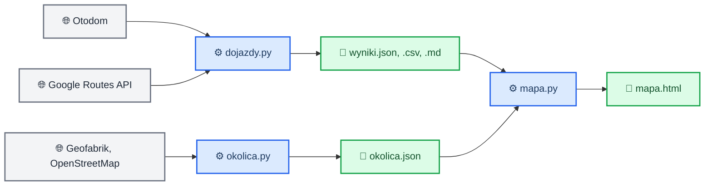

# Mieszkania według dojazdu

Skrypty szukają mieszkań na Otodom i układają je według tego, ile czasu tygodniowo spędzisz w komunikacji miejskiej, dojeżdżając do swoich miejsc: pracy, uczelni, rodziców. Każde miejsce ma wagę (ile razy w tygodniu tam jeździsz) i opcjonalny limit czasu dojazdu. Wyniki przeglądasz na mapie z listą ofert, wariantami tras i okolicą: sklepami, przystankami i parkami.

Projekt jest ustawiony pod Warszawę. Inne miasto wymaga tylko innego adresu wyszukiwania i innego wycinka danych OpenStreetMap (opis w sekcji Konfiguracja).

## ⚡ Szybki start

Potrzebujesz Pythona 3.11 lub nowszego, narzędzia [uv](https://docs.astral.sh/uv/) i klucza Google Maps Platform z włączonym Routes API (opis niżej).

```bash
# 1. środowisko i biblioteki
uv venv -p 3.11
source .venv/bin/activate          # Windows: .venv\Scripts\activate
uv pip install -r requirements.txt

# 2. ustawienia
cp config.example.toml config.toml # Windows: copy config.example.toml config.toml
# uzupełnij config.toml: adres wyszukiwania Otodom, klucz Google, swoje miejsca

# 3. uruchomienie
python dojazdy.py                  # oferty, czasy dojazdu, warianty tras
python okolica.py                  # sklepy, przystanki, parki (raz w miesiącu)
python mapa.py                     # strona mapa.html, otwiera się w przeglądarce
```

> 💡 Pierwsze uruchomienie `dojazdy.py` trwa dłużej, bo skrypt otwiera kartę każdej oferty i pobiera trasy. Kolejne korzystają z zapamiętanych danych i pytają tylko o nowe oferty.

## 🔄 Jak to działa

Dane zbierają dwa niezależne skrypty, a trzeci składa z nich stronę. Sama strona pobiera z sieci tylko podkład mapy, bibliotekę Leaflet, czcionkę i zdjęcia ofert.



| Skrypt | Co robi | Kiedy uruchamiać |
| --- | --- | --- |
| `dojazdy.py` | Pobiera oferty z wyszukiwania Otodom, odrzuca oferty bez ceny i ze zbyt późnym rokiem budowy, liczy czasy dojazdu, układa ranking i pobiera do 3 wariantów trasy do każdego miejsca | Codziennie albo kiedy chcesz |
| `okolica.py` | Pobiera wycinek OpenStreetMap dla Mazowsza i wyciąga z niego supermarkety, sklepy spożywcze, stacje metra i kolei, przystanki tramwajowe, siłownie, apteki, paczkomaty i parki | Raz w miesiącu |
| `mapa.py` | Składa stronę `mapa.html` z wyników i danych okolicy | Po każdym z powyższych |

Ranking liczy łączny czas w drodze w tygodniu: dla każdego miejsca czas dojazdu w jedną stronę × 2 × `razy_w_tygodniu`. Czasy i trasy dotyczą przyjazdu w najbliższy wtorek o 9:00, według rzeczywistych rozkładów.

Na stronie `mapa.html` lista ofert stoi obok mapy, a numery ofert są wspólne dla listy i mapy. Szerokość listy zmienisz, przeciągając jej krawędź; podwójne kliknięcie przywraca domyślną. Po kliknięciu oferty albo strzałki po jej prawej stronie pojawiają się:

- **Szczegóły:** galeria wszystkich zdjęć (kliknięcie w lewą lub prawą połowę zdjęcia przewija), pod nią rzut mieszkania, jeśli ogłoszeniodawca go dodał, a dalej piętro z windą, stan, budynek, ogrzewanie, ogłoszeniodawca, data dodania, dodatki.
- **Dojazdy:** najszybszy wariant do każdego miejsca, a pod linkiem pozostałe. Najechanie rysuje trasę na mapie, kliknięcie rozpisuje przesiadki.
- **Okolica:** najbliższe miejsce każdego rodzaju w promieniu 1 km, dla metra i kolei 2 km.

Strzałka zwija ofertę i czyści mapę. Kliknięcie numeru oferty ją zaznacza, a filtry pokazują wszystkie, zaznaczone albo nowe od ostatniego uruchomienia. Zaznaczenia i szerokość listy zapamiętuje przeglądarka.

## ⚙️ Konfiguracja

Ustawienia są w `config.toml`, który tworzysz z szablonu `config.example.toml`. Szablon ma przykładowe wartości i komentarze.

| Klucz | Znaczenie |
| --- | --- |
| `otodom_url` | Adres strony z wynikami wyszukiwania na otodom.pl. Filtry (cena, metraż, pokoje, dzielnice, rynek) ustawiasz w przeglądarce i kopiujesz adres |
| `[filtry] max_rok_budowy` | Pomija oferty z późniejszym rokiem budowy, a inwestycje z późniejszym terminem oddania. Oferty bez ceny są pomijane zawsze |
| `[google] api_key` | Klucz Google Maps Platform z włączonym Routes API |
| `[[miejsca]] nazwa` | Nazwa miejsca na liście i mapie |
| `[[miejsca]] wspolrzedne` | Np. `"52.2297, 21.0122"`. W Google Maps kliknij miejsce prawym przyciskiem i kliknij w liczby, a skopiują się w tym formacie |
| `[[miejsca]] razy_w_tygodniu` | Waga miejsca: ile razy w tygodniu tam jeździsz |
| `[[miejsca]] max_minut` | Opcjonalny limit: oferty z dłuższym dojazdem w jedną stronę odpadają |

### Klucz Google

1. W [Google Cloud Console](https://console.cloud.google.com/) utwórz projekt.
2. Podepnij konto rozliczeniowe. Google wymaga karty nawet przy korzystaniu wyłącznie z darmowego limitu.
3. Włącz **Routes API**. Obejmuje ono zarówno macierz czasów, jak i trasy.
4. W „Dane logowania” utwórz klucz API i ogranicz go do Routes API.
5. Wpisz klucz do `config.toml`.

Dla spokoju ustaw w konsoli alert budżetowy, np. na 1 zł. Nie blokuje on zapytań, ale wyśle maila, gdy cokolwiek zacznie kosztować.

### Inny region

Oferty bierzesz z dowolnego wyszukiwania Otodom. Dane okolicy `okolica.py` pobiera z wycinka dla województwa mazowieckiego. Dla innego regionu zmień stałą `EXTRACT_URL` w `okolica.py` na odpowiedni plik z [download.geofabrik.de](https://download.geofabrik.de/).

## 💾 Pliki tworzone przez skrypty

Wszystkie są w `.gitignore`, bo zawierają dane pobrane z sieci albo Twoje wyniki.

| Plik | Zawartość | Tworzy |
| --- | --- | --- |
| `stan.json` | Współrzędne, rok budowy, parametry, zdjęcia i rzut ofert, żeby nie otwierać ich kart ponownie | `dojazdy.py` |
| `czasy.json` | Czasy dojazdu (30 dni) i licznik zapytań o czasy | `dojazdy.py` |
| `trasy.json` | Warianty tras (30 dni) i licznik zapytań o trasy | `dojazdy.py` |
| `wyniki.md`, `wyniki.csv`, `wyniki.json` | Ranking: do czytania, do Excela, dla strony | `dojazdy.py` |
| `mazowieckie-latest.osm.pbf` | Wycinek OpenStreetMap, kilkaset MB, odświeżany co 30 dni | `okolica.py` |
| `okolica.json` | Sklepy, przystanki, stacje, parki z regionu | `okolica.py` |
| `mapa.html` | Strona z listą i mapą | `mapa.py` |

> ⚠️ Nie usuwaj `czasy.json` ani `trasy.json`. Oprócz zapamiętanych wyników trzymają liczniki zapytań, dzięki którym skrypt nie przekracza darmowego limitu Google.

## 📊 Koszty i limity

Google ma dla obu usług osobne darmowe pule, a skrypt pilnuje ich własnymi licznikami z zapasem.

| Usługa Google | Rozliczanie | Darmowo w miesiącu | Limit w skrypcie |
| --- | --- | --- | --- |
| Compute Route Matrix: czasy dojazdu | Za każdą parę oferta × miejsce[^2] | 10 000[^1] | 9 000 par |
| Compute Routes: warianty tras | Za zapytanie, do 3 wariantów w jednym[^2] | 10 000[^1] | 9 000 zapytań |

- **Miesiąc liczony jak u Google.** Darmowy limit odnawia się o północy czasu pacyficznego[^3], czyli w Polsce ok. 9:00 pierwszego dnia miesiąca. Liczniki skryptu liczą miesiąc tak samo.
- **Mniej zapytań.** Czasy i trasy są zapamiętywane na 30 dni, oferty w tym samym budynku liczą się raz, a miejsca z `max_minut` są liczone najpierw. Oferta, która przekracza limit, nie zużywa zapytań na pozostałe miejsca.
- **Limit jest wspólny dla konta.** Licznik skryptu nie widzi innego użycia tego samego konta rozliczeniowego. Google sumuje darmową pulę dla wszystkich projektów na koncie[^3].
- **Otodom nie ma publicznego API.** Skrypt czyta strony tak jak przeglądarka, z przerwami 1–2 s między zapytaniami. Regulamin portalu nie przewiduje automatycznego pobierania ofert, więc to narzędzie wyłącznie do prywatnego użytku.
- **Okolica nie wysyła zapytań.** Dane pochodzą z wycinka pobieranego raz w miesiącu, a strona liczy odległości lokalnie.

## 🔧 Rozwiązywanie problemów

| Komunikat | Przyczyna | Co zrobić |
| --- | --- | --- |
| `Brak config.toml` | Nie ma pliku ustawień | Skopiuj `config.example.toml` do `config.toml` i uzupełnij |
| `Uzupełnij api_key` | Pusty klucz w `config.toml` | Wpisz klucz Google |
| `Nie udało się odczytać strony 1 wyników z Otodom (HTTP 403)` | Otodom blokuje zapytania | Odczekaj kilka godzin, zawęź wyszukiwanie |
| `Błąd Google Routes API (HTTP 403)` | Routes API nie jest włączone albo brak konta rozliczeniowego | Sprawdź projekt w Google Cloud Console |
| `Wykorzystano limit …` | Skrypt doszedł do swojego miesięcznego limitu | Brakujące czasy i trasy policzy w kolejnym miesiącu |
| `Google odrzuca zapytania (HTTP 429)` | Limit na minutę albo limit ustawiony w konsoli | Brakujące dane pobierze przy kolejnym uruchomieniu |
| `Brak okolica.json` | Nie uruchomiono `okolica.py` | Uruchom `python okolica.py`, potem `python mapa.py` |
| Na stronie: „Tras jeszcze nie pobrano” | Trasy nie zmieściły się w limicie albo był błąd | Uruchom ponownie `python dojazdy.py` |

## 🔗 Źródła danych i licencje

- **Oferty:** [Otodom](https://www.otodom.pl/), wyłącznie do prywatnego użytku.
- **Czasy i trasy:** Google Maps Platform, Routes API. Wyniki są przechowywane najwyżej 30 dni.
- **Okolica:** © współtwórcy OpenStreetMap, licencja ODbL[^4], wycinki z Geofabrik[^5]. Okolica pochodzi z wycinka, a nie z zapytań na żywo, bo publiczne serwery Overpass API są stale przeciążone[^6].
- **Podkład mapy:** Esri World Street Map i World Imagery, z atrybucją na mapie. Kafelki OpenStreetMap nie są używane, bo ich serwery wymagają nagłówka Referer[^7], którego strona otwierana z dysku nie wysyła.
- **Biblioteki i zasoby strony:** [Leaflet](https://leafletjs.com/) (BSD-2-Clause), ikony [Lucide](https://lucide.dev/) (ISC), czcionka Barlow (SIL Open Font License).

[^1]: Google Maps Platform, cennik usług: <https://developers.google.com/maps/billing-and-pricing/pricing>
[^2]: Routes API, zasady rozliczania: <https://developers.google.com/maps/documentation/routes/usage-and-billing>
[^3]: Google Maps Platform, rozliczenia i darmowy limit: <https://developers.google.com/maps/billing/overview/>
[^4]: OpenStreetMap, prawa autorskie i licencja: <https://www.openstreetmap.org/copyright>
[^5]: Geofabrik, pliki do pobrania: <https://download.geofabrik.de/>
[^6]: Zgłoszenie o przeciążeniu publicznego Overpass API, listopad 2026: <https://github.com/b1tw153/Overpass-API/issues/26>
[^7]: Zasady korzystania z kafelków OpenStreetMap: <https://operations.osmfoundation.org/policies/tiles/>
